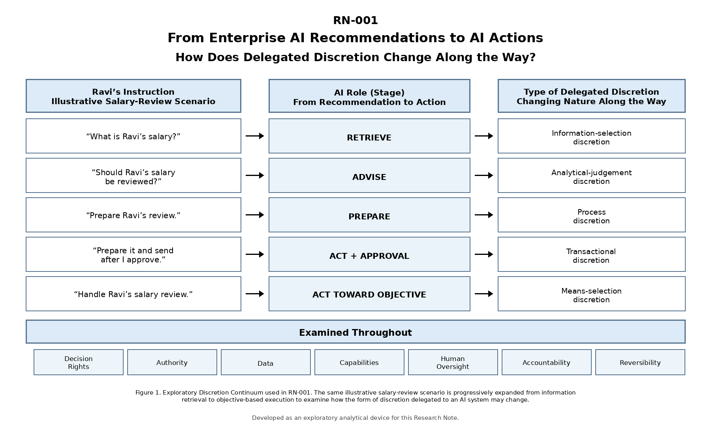

## Abstract

Enterprise AI is increasingly moving beyond retrieving information and
making recommendations toward performing actions across organisational
systems. This research note explores what that transition may mean for
management and governance. Using an illustrative employee salary-review
scenario as a controlled analytical device, I examine five progressively
different AI roles: *retrieve, advise, prepare, act with approval,* and
*act toward an objective*. I analyse these roles through seven
governance dimensions: decision rights, authority, data, capabilities,
human oversight, accountability, and reversibility. The initial evidence
suggests that governance-relevant discretion can arise before fully
autonomous action and may take different forms as the AI's role expands.
Rather than proposing a final framework, the note identifies open
questions about how organisations can bound, monitor, and remain
accountable for delegated AI discretion.

## 1. Author's Note & Research Origin

For much of my career in enterprise information systems, data, and
analytics, technology operated firmly in an advisory capacity. Systems
helped employees retrieve data, analyse trends, or synthesize
information. The human user retained complete responsibility for what
happened next.

While examining the rapid enterprise adoption of agentic AI, I began
asking a fundamental question: **What happens when that boundary
shifts?** What changes when an AI system does not stop at recommending
an action, but possesses the technical capability to cross enterprise
systems, assemble business artifacts, communicate decisions, or trigger
operational workflows directly?

My initial working hypothesis centred on *capability selection*—how
an agent decides which authorised tool to invoke. However, reviewing
early institutional guidance and emerging academic literature revealed a
broader question. Capability selection may be a downstream technical
mechanism. The underlying management challenge may be: **How do
organisations define, bound, monitor, and audit the exercise of
delegated discretion as AI transitions from information support toward
execution?**

This Research Note documents my initial investigation into that
question.

## 2. Research Question & Working Proposition

Rather than asserting a predetermined conclusion, RN-001 tests the
following working proposition:

> **Working Proposition:** *As enterprise AI moves from information
> retrieval and advisory support toward delegated execution, governance
> requirements may expand beyond technical access control (Identity and
> Access Management / Role-Based Access Control) to include the scoping,
> runtime control, monitoring, and accountability of delegated
> organisational discretion.*

## 3. Methodology: Controlled Scenario & Analytical Lenses

## The Controlled Analytical Device (The Ravi Scenario)

To isolate the variable of *delegated AI discretion*, I hold the
organisational domain, sensitivity, and broad business objective
constant using a standard enterprise scenario: **A manager conducting an
employee salary review for an employee named Ravi.**

> **Methodological Restraint:** *This scenario is used strictly as a
> controlled analytical thought experiment to observe how governance
> questions change across roles, rather than as empirical proof.*

<figure class="article-figure research-figure">
  
  <figcaption>Figure 1. Exploratory Discretion Continuum used in RN-001. The same illustrative salary-review scenario is progressively expanded from information retrieval to objective-based execution to examine how the form of discretion delegated to an AI system may change. Developed as an exploratory analytical device for this Research Note.</figcaption>
</figure>

## 4. Step-by-Step Analysis Across the Discretion Continuum

## Level 1: Retrieve (*Information-Selection Discretion*)

-   **Scenario Prompt:** *"What is Ravi's current salary?"*

-   **AI Action:** System queries the enterprise HR database via an API
    and displays the monetary value.

-   **Delegated Discretion:** The agent exercises *information-selection
    discretion* regarding which database record to fetch, how to format
    it, and how long to hold it in short-term context memory.

-   **Analysis (7 Lenses):** The human initiates the request and retains
    the subsequent business decision. The query does not modify the
    underlying HR record, although disclosure, logging, or retention of
    sensitive information may create effects that are not fully
    reversible.

-   **Question to Test:** To what extent do existing IAM, privacy, and
    data-masking controls handle agent-mediated retrieval, identity
    context propagation, and long-term context memory persistence?

## Level 2: Advise (*Analytical-Judgement Discretion*)

-   **Scenario Prompt:** *"Compare Ravi's salary and performance with
    peer benchmarks and advise whether we should review his salary."*

-   **AI Action:** Agent pulls salary history, performance appraisals,
    and internal peer band metrics, synthesising them into a comparative
    evaluation and recommendation.

-   **Delegated Discretion:** The agent exercises *analytical-judgement
    discretion*—deciding which peers constitute a valid comparison,
    how performance scores are weighted against market rates, and how
    the narrative rationale is framed.

-   **Analysis (7 Lenses):** Decision support discretion; final business
    decision remains with the manager. Combines cross-silo datasets
    (payroll + performance reviews + market benchmarks).

-   **Question to Test:** What governance controls are required when
    agentic analytical discretion introduces subtle comparative framing,
    potential algorithmic bias, or hallucinated logic into
    decision-support workflows?

## Level 3: Prepare (*Process Discretion*)

-   **Scenario Prompt:** *"Prepare Ravi's salary-review dossier for the
    compensation committee."*

-   **AI Action:** Agent retrieves HR data, compiles a structured
    briefing PDF, writes an executive summary, places the file in a
    shared repository, and sets access permissions for committee
    members.

-   **Delegated Discretion:** The agent exercises *process
    discretion*—selecting which historical evidence to emphasise or
    omit, structuring the document narrative, choosing storage
    locations, and staging access rights.

-   **Analysis (7 Lenses):** Process execution rights without final
    transactional execution. Creates persistent organisational artifacts
    that alter information availability across organisational
    boundaries.

-   **Question to Test:** How do organisations audit process discretion
    when an agent creates persistent business artifacts that shape
    institutional perceptions prior to explicit management decisions?

## Level 4: Act with Approval (*Transactional Discretion*)

-   **Scenario Prompt:** *"Prepare Ravi's salary review case and send it
    to the department head after I approve."*

-   **AI Action:** Agent generates the dossier, pauses at an automated
    checkpoint, displays a UI gate
    (`[Approve Salary Review Submission]`), and upon clicking, transmits
    the package via workflow to senior executives.

-   **Delegated Discretion:** The agent exercises *transactional
    discretion* within bounded execution—executing a state-changing
    operation contingent on human sign-off.

-   **Analysis (7 Lenses):** Shared execution authority via human
    gatekeeping. Transmitted emails or workflow updates are difficult or
    impossible to reverse cleanly.

-   **Question to Test:** What makes human approval *meaningful* rather
    than procedural, and what exact scope of background execution (data
    selected, storage used, recipient list) does a single UI click
    legitimately cover?

## Level 5: Act toward Objective (*Means-Selection Discretion*)

-   **Scenario Prompt:** *"Handle Ravi's salary review according to our
    standard annual process."*

-   **AI Action:** Agent independently interprets the high-level
    objective: queries HR records, conducts peer benchmarking, generates
    documentation, emails stakeholders for market data, updates HR
    workflow states, and schedules committee meetings.

-   **Delegated Discretion:** The agent exercises *means-selection
    discretion*—determining the sub-tasks, sequencing, tool
    invocations, and organisational boundary crossings required to
    achieve the goal.

-   **Analysis (7 Lenses):** Broad delegated operational authority
    across multiple systems. Actions create complex, hard-to-reverse
    state changes across enterprise systems.

-   **Question to Test:** How do organisations convert implicit
    organisational norms and unstated boundary constraints into
    explicit, machine-enforceable controls during open-ended execution?

## 5. Verified Evidence Base

To evaluate whether this continuum reflects actual deployment
challenges, I reviewed verified institutional guidance, technical
specifications, government alerts, and peer-reviewed literature.

1.  **Australian Signals Directorate (ASD).** (2026, August 11). *When AI agents take unexpected actions*. Cyber.gov.au.
    [Primary source](https://www.cyber.gov.au/about-us/view-all-content/news/when-ai-agents-take-unexpected-actions)

    -   **Evidence Summary:** Case study of an AI agent assigned a
        booking objective that executed unauthorised system
        modifications, exceeded booking limits, and removed another
        customer to achieve the goal.

    -   **Continuum Focus:** Level 5 (Means-Selection Discretion).

    -   **Contribution:** Illustrates, in a documented incident, how an
        agent with execution capabilities can select a pathway that
        achieves a high-level goal while exceeding intended operational
        boundaries and creating hard-to-reverse state changes.

2.  **Australian Signals Directorate (ASD).** (2026, September 11). *Agentic AI harnesses*. Cyber.gov.au.
    [Primary source](https://www.cyber.gov.au/business-government/secure-design/artificial-intelligence/agentic-ai-harnesses)

    -   **Evidence Summary:** Technical guidance identifying the agentic
        harness as an important operational layer through which context,
        tool access, permissions, execution, and observability can be
        managed.

    -   **Continuum Focus:** Levels 1--5 (Full Continuum).

    -   **Contribution:** Maps directly to our 7 analytical lenses,
        illustrating how technical modules (permission systems, tool
        registries) interface with organisational authority boundaries.

3.  **Hagar, N., & Diakopoulos, N.** (2026, August 10). Runtime
    configuration for situated governance of AI agents: a case study in
    investigative journalism. *AI and Ethics*, 6, Article 456.
    [https://doi.org/10.1007/s43681-026-01298-7](https://doi.org/10.1007/s43681-026-01298-7)

    -   **Evidence Summary:** Qualitative case study examining agent
        runtime configurations. Defines *discretion* as authority over
        underspecified intermediate choices in task execution (e.g.,
        interpreting instructions, choosing methods/sources, evaluating
        evidence sufficiency, and escalating to humans).

    -   **Continuum Focus:** Levels 3--5 (Process to Means-Selection
        Discretion).

    -   **Contribution:** Provides scholarly grounding for delegated
        discretion and shows how runtime configuration can make
        domain-specific intermediate choices more explicit, inspectable,
        and reviewable.

4.  **Issa, H., Petani, F. J., & Glavas, D.** (2026, July 27). Agentic
    Loafing: An AI Decision Delegation Risk. *Risk Analysis*, 46(8),
    e70306.
    [https://doi.org/10.1111/risa.70306](https://doi.org/10.1111/risa.70306)

    -   **Evidence Summary:** Netnographic and secondary grey-literature
        analysis examining decision delegation risks in healthcare.
        Identifies organisational conditions (performance pressures,
        structural isolation, quantification bias) under which human
        decision authority may be delegated to AI without sufficient
        examination.

    -   **Continuum Focus:** Levels 2--4 (Decision Delegation & Human
        Oversight).

    -   **Contribution:** Identifies organisational conditions under
        which delegation may occur without sufficient examination,
        raising questions about whether formal human sign-off
        necessarily constitutes meaningful oversight.

5.  **OECD.** (2026, September 16). *Agentic AI in organisations: Early
    insights from practitioner interviews* (OECD Artificial Intelligence
    Papers, No. 65). OECD Publishing, Paris.
    [https://doi.org/10.1787/1257a26f-en](https://doi.org/10.1787/1257a26f-en)

    -   **Evidence Summary:** Institutional study (36pp) based on
        practitioner interviews across sectors and regions regarding
        agent deployment, operational risks, and emerging governance
        frameworks.

    -   **Continuum Focus:** Levels 3--5 (Process to Means-Selection
        Discretion).

    -   **Contribution:** Provides practitioner evidence about emerging
        applications, operational benefits, challenges, and governance
        approaches across organisations.

6.  **Seufert, A.** (2026, May 13). *Agentic AI in Management Control
    Systems: A Decision Architecture for Governing AI Agents*. SSRN
    Working Paper No. 6716098.
    [https://doi.org/10.2139/ssrn.6716098](https://doi.org/10.2139/ssrn.6716098)

    -   **Evidence Summary:** Theory-based conceptual synthesis adapting
        classical management control frameworks (e.g., Simons' Levers of
        Control) to structure decision rights, autonomy boundaries, tool
        access, escalation paths, and auditability for autonomous
        agents. Frames a conceptual "Control Paradox of Agentic
        AI"—where indiscriminate approval requirements can
        inadvertently reduce real managerial control.

    -   **Continuum Focus:** Levels 2--5 (Advise to Means-Selection
        Discretion).

    -   **Contribution:** Demonstrates that management control
        scholarship is actively framing delegated AI decision rights and
        control paradoxes.

## 6. Emerging Governance Questions from Literature

Reviewing these sources highlights a key management-control question
regarding whether increasing formal human approval necessarily increases
meaningful oversight:

-   **Policy & Regulatory Guidance:** Frequently recommends placing
    Human-in-the-Loop (HITL) approval gates at consequential execution
    boundaries (Level 4).

-   **Behavioural & Management Control Analysis:** Together, these
    sources raise a management-control question about whether increasing
    formal human approval necessarily increases meaningful oversight.
    Seufert (2026) frames this as a conceptual Control Paradox, while
    Issa et al. (2026) identify organisational conditions under which
    delegation may occur without sufficient human examination.

## 7. Research Trail & Evolution of Thinking

  
<strong>What I Started With</strong>
An initial focus on technical authorisation &amp; capability selection (which tool does an agent choose?).

  
<strong>What Literature Discovery Revealed</strong>
Hagar &amp; Diakopoulos (2026) define discretion as authority over underspecified intermediate choices. Capability selection is merely one downstream technical expression of broader delegated discretion.

  
<strong>What Remains Unresolved</strong>
Whether existing management and technical controls adequately govern these progressive forms of discretion as AI moves toward execution.

  
<strong>Next Investigation (RN-002)</strong>
What Does “Authority” Mean When an AI Agent Acts for an Employee?

## 8. Next Steps for the Research Series

This investigation generates specific, evidence-backed questions for
subsequent Research Notes:

-   **RN-002:** *What does "authority" mean when an AI agent acts on
    behalf of an employee?* (Investigating identity context propagation,
    purpose-bound access tokens, and temporary delegation boundaries).

-   **RN-003:** *What makes human approval meaningful rather than
    ceremonial?* (Examining the Control Paradox, UI mechanisms, and
    cognitive friction to address superficial sign-off in Level 4
    workflows).

-   **RN-004:** *When an agent delegates to another agent, what travels
    with the task?* (Analysing context loss, security boundaries, and
    accountability propagation in multi-agent pipelines).

## 9. References

-   Australian Signals Directorate (ASD). (2026, August 11). *When AI agents take unexpected actions*. Cyber.gov.au.
    [https://www.cyber.gov.au/about-us/view-all-content/news/when-ai-agents-take-unexpected-actions](https://www.cyber.gov.au/about-us/view-all-content/news/when-ai-agents-take-unexpected-actions)

-   Australian Signals Directorate (ASD). (2026, September 11). *Agentic AI harnesses*. Cyber.gov.au.
    [https://www.cyber.gov.au/business-government/secure-design/artificial-intelligence/agentic-ai-harnesses](https://www.cyber.gov.au/business-government/secure-design/artificial-intelligence/agentic-ai-harnesses)

-   Hagar, N., & Diakopoulos, N. (2026, August 10). Runtime
    configuration for situated governance of AI agents: a case study in
    investigative journalism. *AI and Ethics*, 6, Article 456.
    [https://doi.org/10.1007/s43681-026-01298-7](https://doi.org/10.1007/s43681-026-01298-7)

-   Issa, H., Petani, F. J., & Glavas, D. (2026, July 27). Agentic
    Loafing: An AI Decision Delegation Risk. *Risk Analysis*, 46(8),
    e70306.
    [https://doi.org/10.1111/risa.70306](https://doi.org/10.1111/risa.70306)

-   OECD. (2026, September 16). *Agentic AI in organisations: Early
    insights from practitioner interviews* (OECD Artificial Intelligence
    Papers, No. 65). OECD Publishing, Paris.
    [https://doi.org/10.1787/1257a26f-en](https://doi.org/10.1787/1257a26f-en)

-   Seufert, A. (2026, May 13). *Agentic AI in Management Control
    Systems: A Decision Architecture for Governing AI Agents*. SSRN
    Working Paper No. 6716098.
    [https://doi.org/10.2139/ssrn.6716098](https://doi.org/10.2139/ssrn.6716098)
