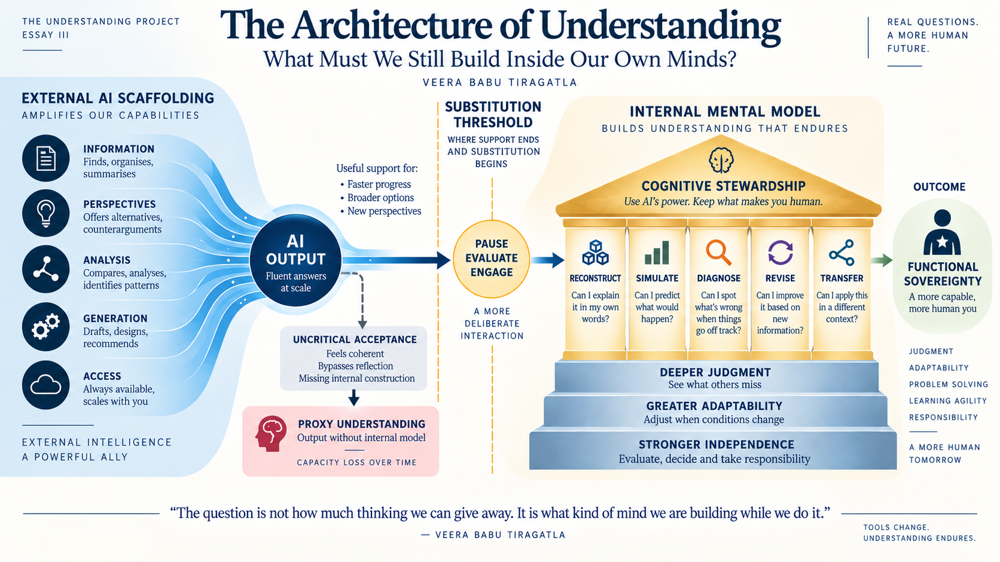

# The Architecture of Understanding

What Must We Still Build Inside Our Own Minds?

Veera Babu Tiragatla &middot; The Understanding Project &middot; Essay III &middot; 20-minute read

<figure class="article-figure article-figure-wide understanding-architecture-figure">
  
</figure>

In the first essay in this series, [Understanding Drift](https://www.veerababutiragatla.com/understanding-drift/), I explored a gap that is becoming easier to see in everyday work.

AI can help us produce the language of understanding before we have fully built the understanding underneath it.

A report becomes a summary.

A difficult subject becomes an elegant explanation.

A complicated technical problem becomes a structured recommendation.

The output can be useful. It can even be right.

But the person receiving it may not yet possess enough of the underlying model to explain why it is right, recognise when it stops being right, or adapt it when the situation changes.

I called that gap Understanding Drift.

In the second essay, [Can Understanding Be Delegated?](https://www.veerababutiragatla.com/can-understanding-be-delegated/), I followed the problem further.

If AI can increasingly frame, compare, interpret, synthesise and recommend for us, then the question is not simply whether those activities can be delegated.

Clearly, many of them can.

The harder question is whether we still understand enough to judge what comes back.

That led to ideas such as Proxy Understanding, Evaluation Dependency, and the Epistemic Delegation Boundary.

But that essay left me with another question.

Perhaps the most important one.

If good judgement still depends on something we have built inside ourselves, what exactly is that something?

What does understanding look like before it becomes an answer?

How does information become a structure we can reason through?

And as external intelligence becomes permanently available, what must we continue building inside our own minds?

That is the question of this essay.

## 1. The Construction Problem

Over the years, I have worked with many kinds of enterprise systems and data environments.

Databases.

Data warehouses.

SAP landscapes.

Business intelligence platforms.

Real-time systems.

Cloud platforms.

And now AI-assisted work.

The technologies changed enormously. But one pattern kept returning.

Someone could learn the procedure without really understanding the system.

They could follow the documented sequence.

They could execute the transaction.

They could reproduce the report.

They could explain what the architecture diagram showed.

Then one condition changed.

A source field changed. A dependency failed. A batch arrived late. A business rule behaved differently from what the documentation suggested.

Suddenly the procedure was no longer enough.

The person had to reason.

That is usually where understanding becomes visible.

Not while everything is behaving normally.

But when reality moves outside the expected path.

This is why having an answer available is not the same as having understanding available inside the mind. **Philip Johnson-Laird's** work on mental models gives us useful language for this: reasoning depends partly on internal representations of situations and possibilities, not only isolated facts. [Mental models and human reasoning](https://doi.org/10.1073/pnas.1012933107)

That distinction sounds academic until you see it in real work.

Imagine receiving a complete migration recommendation from an AI system.

The architecture looks sensible.

The dependencies are listed.

The risks are documented.

The terminology is correct.

You may understand every sentence.

But now remove the explanation.

Can you reconstruct the important relationships yourself?

Can you explain which assumption carries the design?

Can you predict what happens if that assumption changes?

Can you recognise a dependency the proposal forgot?

If not, something important is still sitting outside you.

The answer is available.

The structure that makes the answer judgeable may not be.

This is the construction problem.

AI makes it more important because it does not simply retrieve information.

It increasingly performs some of the work we previously used to construct understanding.

It frames.

It connects.

It compares.

It explains.

It proposes.

It sometimes gives us what feels like finished thought.

That can be extraordinarily useful.

But it creates a new question:

After the external system has finished its work, what has actually been built inside me?

## 2. What an Internal Model Actually Looks Like

When I use the term mental model, I do not mean that we carry a perfect copy of reality inside our heads.

We obviously do not.

No experienced architect remembers every table, interface, business rule, and exception simultaneously.

What experience seems to create instead is a structure.

Certain relationships become connected.

- Which dependencies matter.
- Which failures tend to travel downstream.
- Which business rules look simple until operational reality interferes.
- Which technical improvement creates a new governance problem somewhere else.
- Which apparently minor assumption can destabilise an entire design.

That structure is different from knowing more facts.

Consider a simple architecture:

**SAP system  ->  extraction  ->  cloud platform  ->  analytics**

Someone can memorise that sequence in a few seconds.

But the diagram tells us almost nothing about the real system.

- Where do the business definitions come from?
- Which transformations happen before the data reaches analytics?
- Who owns those rules?
- What latency is acceptable?
- What happens if a source schema changes?
- Does security remain consistent across platforms?
- What data is copied and what is virtualised?
- Which users make operational decisions from the result?
- Which regulatory constraint becomes important only after data crosses a boundary?

The architecture begins to mean something only when those relationships start connecting.

That is what experienced people often carry.

Not every detail.

A map of what affects what.

Cognitive-load research helps explain why expertise feels different from beginner knowledge. As knowledge becomes organised into larger schemas, many small pieces can be treated as meaningful units rather than separate items competing for working memory. [John Sweller - Cognitive load during problem solving](https://doi.org/10.1207/s15516709cog1202_4)

I have seen this difference many times in technical training.

A beginner often looks at ten separate details.

An experienced practitioner may see one pattern.

That does not mean the expert is always right.

Experience can produce blind spots too.

But it gives the person something that a list of facts cannot provide: a structure they can interrogate.

This is also why AI-generated explanations can feel so convincing.

The system can provide the structure externally.

It can tell us what relates to what. It can give us the trade-offs. It can organise the whole subject beautifully.

We recognise the coherence.

But recognising a coherent explanation is not necessarily the same as constructing the coherence ourselves.

<!-- Citation correction, 4 October 2026: replaced an unrelated IEEE DOI with Koriat (1997), DOI 10.1037/0096-3445.126.4.349. -->

Koriat's research on judgements of learning, including [*Monitoring One's Own Knowledge during Study: A Cue-Utilization Approach to Judgments of Learning*](https://doi.org/10.1037/0096-3445.126.4.349), examines how people infer what they have learned from cues whose relationship to later recall can vary. Applied to AI-assisted reading, this suggests a useful caution: feeling that an explanation is clear does not, by itself, establish that we can later use its relationships.

Something can feel clear while we are reading it and disappear when we have to rebuild it ourselves.

That gives me a simple test:

A mental model is not defined by how familiar an explanation feels. It is revealed by what we can still do with the relationships when the explanation is gone.

That is a much harder standard.

I think it is becoming a more useful one.

## 3. Understanding Should Let Us Predict Something

A model becomes interesting when it can do more than describe what already happened.

It should allow us to ask:

If this changes, what should happen next?

That question is simple.

But it reveals a great deal.

Suppose a reporting workload slows down after a migration.

A shallow response may list possible causes.

Network.

Storage.

Concurrency.

Model design.

Source latency.

All plausible.

But a person with a developed internal model begins doing something different.

They start predicting.

- If source latency is the issue, what else should I observe?
- If concurrency is the cause, when should the slowdown appear?
- If a semantic-layer change caused the problem, which reports should be affected and which should remain normal?
- If my first explanation is correct, what evidence would prove it wrong?

That is mental simulation.

We do this constantly in professional work, often without giving it a name.

We build an expectation.

Reality gives us an outcome.

Then we compare them.

When the two do not match, we learn something about the model.

This is why error can be valuable.

Not because failure is inherently good.

But because a failed expectation can expose a missing relationship.

Research on conceptual change shows that simply giving people the correct information does not always rebuild the model underneath an existing belief. [Stella Vosniadou - conceptual change](https://doi.org/10.1016/0959-4752(94)90018-3) People can absorb a new fact while leaving the older framework largely intact.

Research on knowledge revision reaches a related conclusion: prior expectations and conflicting information need to become active together before the contradiction can be examined properly. [Kendeou, Walsh, Smith & O'Brien - knowledge revision](https://doi.org/10.1080/0163853X.2014.913961)

Again, this is easier to understand through ordinary work.

Suppose I believe that moving a workload to a modern cloud platform automatically improves governance.

Someone gives me a sophisticated explanation of lineage, access controls, metadata and policy.

I may repeat all of it accurately.

But unless I confront my original assumption - that modernisation itself creates governance - I may still carry the old model underneath the new language.

The vocabulary changes.

The model does not.

That is why one sentence has stayed with me throughout this project:

An answer can correct a conclusion without correcting the model that produced the conclusion.

Generative AI makes this particularly easy.

It can give us the corrected answer before we have exposed our own expectation.

No prediction.

No visible contradiction.

No moment where we have to say: I thought X. The evidence says Y. What did my model miss?

So when I actually want to learn something, I increasingly prefer a different sequence.

1. Form an expectation first.
1. Ask the system.
1. Compare the answer with the expectation.
1. Explain the difference.
1. Revise the model.

The AI still helps me.

Sometimes it helps a great deal.

But it enters the process after I have exposed enough of my own model for the interaction to change me.

That is a very different cognitive experience from simply receiving the finished explanation.

## 4. Scaffold or Substitute?

This distinction began to matter more to me as I used AI more often.

There are times when AI clearly makes my thinking better.

I may already have an argument.

I ask the system to challenge it.

It finds a counterexample.

I disagree.

It finds another.

I realise one assumption is weaker than I thought.

I revise the argument.

In that interaction, AI did a lot.

But it did not remove me from the reasoning.

It created pressure on my model.

That is scaffolding.

Then there are other interactions.

I know almost nothing about a topic.

I ask the system to identify the problem, organise the relevant concepts, compare the evidence, weigh the alternatives and give me a conclusion.

The result may be excellent.

But the cognitive path is different.

Much of the relational work has already happened before I enter the answer.

That is closer to substitution.

Neither condition is automatically good or bad.

That point matters.

Cognitive offloading is normal human behaviour. We use tools, notes, calculators, reminders and external systems partly because our attention and working memory are limited. Offloading can make us more effective, not less. [Risko & Gilbert - Cognitive Offloading](https://doi.org/10.1016/j.tics.2016.07.002)

I have no interest in manually reproducing work that machines can perform reliably simply to prove that I can.

That would turn learning into ritual.

The real question is:

What am I offloading?

If I offload arithmetic so that I can think more clearly about an architecture, that may increase my cognitive leverage.

If I offload formatting so that I can focus on argument, that may be useful.

If I offload repetitive code so that I can think about the data semantics, that may be useful too.

But if I continually offload the exact operation through which I would normally learn to identify dependencies, evaluate trade-offs or diagnose contradictions, the trade-off is different.

Recent evidence makes this distinction worth taking seriously.

In a large field experiment in high-school mathematics, unrestricted GPT-based assistance improved performance while the tool was available, but students later performed worse on an unassisted test. A more deliberately designed tutoring condition largely mitigated that problem. [Bastani et al. - Generative AI without guardrails can harm learning](https://doi.org/10.1073/pnas.2422633122)

That does not show that AI is bad for learning.

It shows that the design of the interaction matters.

A broader 2026 meta-analysis of 36 studies and 7,229 participants found an overall positive effect of GenAI on learning outcomes, including higher-order learning. Teaching method was the only significant moderator in that analysis. [Fan, Ke, Chen & Lv - three-level meta-analysis](https://doi.org/10.3389/fpsyg.2026.1758670)

Those findings belong together.

We should stop asking: Is AI good or bad for thinking?

The question is too crude.

A better question is:

What kind of AI interaction leaves enough model-building work inside the learner?

There is another complication.

The right amount of support depends on the person.

A beginner may need structure. An expert may need challenge. Research on the expertise-reversal effect shows that instructional support that helps less experienced learners can become redundant or even counterproductive as expertise increases. [Kalyuga, Ayres, Chandler & Sweller - The Expertise Reversal Effect](https://doi.org/10.1207/S15326985EP3801_4)

That also matches what I have seen.

Give a junior analyst a completely open diagnostic problem and they may not yet know where to begin.

Give them a constrained set of possibilities and they can start learning the relationships.

Give the same list immediately to a senior practitioner and you may simply stop them from exercising a diagnostic capability they already possess.

The tool is identical.

The cognitive role is not.

This led me to another boundary that I find useful.

I call it the substitution threshold.

The threshold is crossed when the external system begins performing a cognitive operation that the person will later need to perform independently.

That creates a practical question:

Do I still need to be able to do this when the AI is wrong, incomplete, unavailable, or operating outside the assumptions that make its answer useful?

If the answer is no, delegation may be perfectly sensible.

If the answer is yes, we should be more deliberate.

## 5. Five Questions I Now Use to Test Understanding

The previous essay asked whether we still possess enough understanding to evaluate delegated work.

But that creates another problem.

How do we know what is actually inside us?

The quality of the final output is no longer enough.

A polished report can be produced with very little internal understanding.

A rough explanation can come from someone who understands the system deeply but communicates imperfectly.

So instead of testing appearance, I think we need to test the model.

These are not a formal psychological test. I do not present them as one.

They are five practical questions that emerged from the research and from the problem this series has been examining.

### 1. Reconstruct - Can I rebuild the important structure without looking at the answer?

Not the exact wording. Not every detail. Can I reproduce the important relationships? If an architecture disappears from the screen, can I redraw enough of it to explain what depends on what? If not, perhaps more of the structure remains external than I realised.

### 2. Simulate - If one condition changes, can I anticipate what should happen next?

What if latency doubles? What if a schema changes? What if an approval step disappears? What if an AI agent gains access to one additional system? A model that cannot survive variation may be descriptive rather than functional.

### 3. Diagnose - Can I recognise when a plausible answer does not fit?

This may be the most important question in an AI-rich environment. The difficult output is rarely nonsense. It is often coherent, polished and mostly right. The test is whether I can notice the one missing dependency inside an otherwise excellent answer.

### 4. Revise - When evidence contradicts me, can I identify what in my model needs to change?

Accepting a correction is easy. Revising the structure that produced the original error is harder. If my prediction fails, can I locate the assumption that failed with it? That is where learning becomes structural rather than cosmetic.

### 5. Transfer - Can I recognise the same relationship in a different context?

If I understand unclear ownership in an enterprise data platform, can I recognise the same structural problem in an AI-agent workflow, a hospital process, or a research team? When the surface changes but the relationship remains visible, the model has become more portable.

The diagnostic question is especially important because epistemic-vigilance research examines how people assess communicated information, while human-factors research shows how highly reliable automation can reduce active monitoring. [Sperber et al. - Epistemic Vigilance](https://doi.org/10.1111/j.1468-0017.2010.01394.x) [Parasuraman & Manzey - automation complacency and bias](https://doi.org/10.1177/0018720810376055)

The transfer question draws on analogical-reasoning research that emphasises relational structure rather than surface similarity. [Dedre Gentner - Structure-Mapping](https://doi.org/10.1207/s15516709cog0702_3)

Taken together, these questions tell us something that an answer alone cannot.

Not whether a person is intelligent.

Not whether they used AI.

Not whether they can work without tools.

But whether enough of the relational structure remains available internally to support judgement.

Understanding is not binary.

We can understand something partially.

We can have a good model with weak calibration.

We can understand one context and fail to transfer the principle elsewhere.

We can reconstruct a system but fail to diagnose a subtle omission.

The point is not to declare: I understand.

The point is to discover where the understanding still depends on external support.

That is a much more useful question.

## 6. From Understanding Stewardship to Cognitive Stewardship

In Understanding Drift, I introduced the idea of Understanding Stewardship.

The response to drift could not simply be using less AI.

It had to involve taking more deliberate care of the human capabilities that AI was beginning to support.

The second essay carried that idea further.

If we delegate cognitive work, we also need to preserve enough understanding to evaluate the result.

This third essay takes one more step.

I now think the broader problem is best understood as cognitive stewardship.

By that I mean something simple:

Being deliberate about which cognitive operations we externalise and which internal capabilities we continue to practise because future judgement still depends on them.

This does not mean preserving every old skill.

We do not become wiser by refusing calculators.

We do not become deeper thinkers by memorising information a reliable system can retrieve in seconds.

We do not need to reproduce routine work merely because people once did it manually.

Progress has always involved deciding what no longer deserves human effort.

But some cognitive capacities have two functions.

They produce work.

And they also help us evaluate work.

- Diagnostic reasoning.
- Causal understanding.
- The ability to detect a missing assumption.
- Epistemic vigilance.
- The ability to transfer a principle into a new context.

These capabilities may become less necessary during ordinary operation precisely as they become more important when ordinary operation fails.

That is the paradox.

The better external intelligence becomes, the easier it is to stop practising the capacities required to challenge it.

Poor systems invite inspection.

Very good systems invite trust.

And trust is efficient.

Until the unusual case arrives.

A regulation changed.

The data is incomplete.

The customer behaves differently.

The operating environment has shifted.

The model confidently answers the wrong question.

Someone still has to notice.

This is why I keep returning to another line that emerged while working through this series:

Understanding is not only the capacity to produce an answer. It is also the capacity to resist an answer when the underlying structure does not make sense.

That is not scepticism for its own sake.

It is not distrusting AI.

It is not trying to prove human superiority.

It is the simple ability to say:

This sounds right. But it does not fit what I know about the system. Let me find out why.

That is a different form of competence from producing the first answer.

I suspect it will become more valuable as first answers become cheaper.

## What We May Need to Keep

The more I work with AI, the less interested I become in asking whether people should use AI less.

That is the wrong level of the problem.

The better question is:

What should remain humanly practised?

For one person, it may be problem framing.

For another, diagnosis.

For another, evaluation of evidence.

For another, understanding operational consequences.

It will depend on the domain and on responsibility.

A person asking AI to improve the wording of an email does not need to preserve an internal theory of language generation.

A junior analyst learning architecture may need significant assistance before they can reason independently.

A senior architect approving a high-risk design carries a different burden.

If the decision becomes consequential, the depth of the model matters more.

So I would tie stewardship to responsibility.

Which capacities must remain available because I may eventually be responsible for judging the external system?

That question avoids two extremes.

It avoids the romantic idea that everything should remain human.

And it avoids the equally simplistic idea that everything machines can do should immediately be externalised.

The sensible boundary lies somewhere between them.

## The Architecture We Are Building

When I began The Understanding Project, I thought the central problem was mostly about AI.

I am less sure now.

AI exposed the problem.

But the deeper subject is human understanding itself.

The first essay asked what happens when expression begins to outrun comprehension.

The second asked what happens when cognitive work is delegated and we still have to judge the result.

This essay has asked what must remain inside us for that judgement to be possible.

The answer is not everything.

Not every fact.

Not every procedure.

Not every calculation.

Not every first draft.

What seems to matter is something more structural.

- Enough of an internal model to reconstruct the important relationships.
- Enough to form expectations.
- Enough to notice when reality disagrees.
- Enough to challenge a plausible answer.
- Enough to revise.
- Enough to carry the principle somewhere new.
- Enough to remain responsible when the decision finally belongs to us.

AI can help us build those capacities.

Sometimes better than we could build them alone.

It can show us alternatives.

Challenge our assumptions.

Expose gaps.

Generate counterexamples.

Explain a difficult concept three different ways.

Give a beginner a path into a subject that once felt inaccessible.

That is real cognitive leverage.

But the same technology can also provide the conclusion before we have formed the question.

It can provide the interpretation before we have inspected the evidence.

It can provide the structure before we have tried to construct one.

The difference is not simply in the machine.

It is in the relationship we build with it.

Perhaps that is the larger lesson of these three essays.

The AI era does not require us to choose between human intelligence and artificial intelligence.

That is too simple.

The real design problem is how the two should fit together.

- What should the system carry?
- What should the person still practise?
- Where can work be delegated safely?
- Where does evaluation require deeper internal understanding?
- And when assistance is removed, what remains?

For centuries, we designed tools around the limits of the human mind.

We are entering a period in which we may increasingly design our habits, learning and professional roles around the permanent availability of intelligent tools.

That change deserves more attention than productivity alone can give it.

Because every time a tool takes over part of the cognitive journey, we are making two decisions.

One about the task.

And another, often without noticing, about the kind of mind we are continuing to build.

The first decision determines what gets done.

The second determines who we remain capable of being when the answer is no longer obvious.

That is why I no longer think the important question is:

How much thinking can we give away?

The question I would rather leave with is:

What kind of mind are we building while we do it?

That, ultimately, is the architecture of understanding.

## About the author

Veera Babu Tiragatla writes about enterprise systems, AI, and the human side of understanding. His work draws on experience across enterprise data, SAP, analytics, technical training, and emerging AI systems, with a particular interest in what happens to human judgement as intelligent systems participate more deeply in professional thinking.

*The Architecture of Understanding is Essay III in The Understanding Project, following Understanding Drift and Can Understanding Be Delegated?.*

<nav class="understanding-series-nav" aria-label="The Understanding Project essays">
  
<a href="/research/the-understanding-project/">The Understanding Project</a>

  <a href="/understanding-drift/">Essay I<strong>Understanding Drift</strong></a>
  <a href="/can-understanding-be-delegated/">Essay II<strong>Can Understanding Be Delegated?</strong></a>
  
Essay III · Current<strong>The Architecture of Understanding</strong>

</nav>
